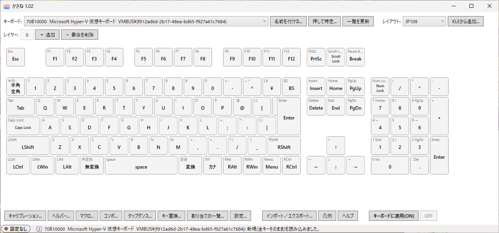

# kasane

[日本語](README.md)

kasane is a tool that changes how the keys on a Windows keyboard behave. For each keyboard, you can swap keys, switch layers, change what a key does depending on whether you hold or tap it (Mod-Tap and Layer-Tap), and use macros, combos, tap dance and thumb-shift (NICOLA). It can also import nodoka configuration files.

Key input is handled by a keyboard filter driver (`kbdlayer.sys`).



## Getting kasane and system requirements

Prebuilt kasane 1.03 is sold on Gumroad.

- Subscription edition: https://applet.gumroad.com/l/crijiq
- Pro edition (one-time purchase): https://applet.gumroad.com/l/icbqj
- Trial version (a Subscription evaluation license key and zip file): https://applet.gumroad.com/l/nbmmf

The trial works for 6 days. If you later buy a Subscription license key and enter it, it becomes the Subscription edition.

System requirements:

- Windows 11 25H2 (x64 or ARM64)
- Administrator rights for installation
- An internet connection, used to check the license key (see "License activation" in the help for details)
  - Subscription edition connects to `https://kasane-license.applet-llc.workers.dev`
  - Pro edition connects to `https://api.gumroad.com/v2/licenses/verify` (once, during installation)
  - Both use HTTPS (port 443). If your network, such as a company network, blocks them, the license cannot be checked.

The help covers everything from installation to every feature.

- [Help contents](docs/manual/src/en/index.md)

## Repository layout

| Folder | Contents |
|---|---|
| `driver/kbdlayer` | Keyboard filter driver (x64, ARM64) |
| `kasane` | Settings editor (WPF) |
| `kasane-tray`, `kasane-tray-uia` | Tools that stay in the system tray |
| `kasane-license`, `kasane-license-svc` | License management (Subscription edition) |
| `kasane-pro-activator` | License check during installation (Pro edition) |
| `kasane-launcher` | Launcher that starts the Pro edition installer |
| `setup`, `setup-pro` | Installers built with WiX |
| `kasane.Tests` | Unit tests and UI Automation tests |
| `docs` | Help and documentation |

## Building

You need Visual Studio 2022 and the WDK. Build `kasane.sln` as Release|x64. Run the tests with this command:

```powershell
dotnet test kasane.Tests
```

A driver you build must be signed before it can be loaded on a real machine.

## Contributors

- Applet LLC: planning, development, and testing on real hardware
- Claude (Anthropic's AI): design discussion, implementation, testing support, and documentation. Recorded as `Co-Authored-By` in the commits

## License

The source code in this repository is released under the [Apache License 2.0](LICENSE).

The following are not covered by it:

- The prebuilt binaries sold on Gumroad come with a separate end-user license (`setup/License`).
- Some files that carry over source code from nodoka4 follow the Eclipse Public License 2.0.
- Other third-party software is listed in [THIRD-PARTY-NOTICES.txt](THIRD-PARTY-NOTICES.txt) and the `third-party` folder.
