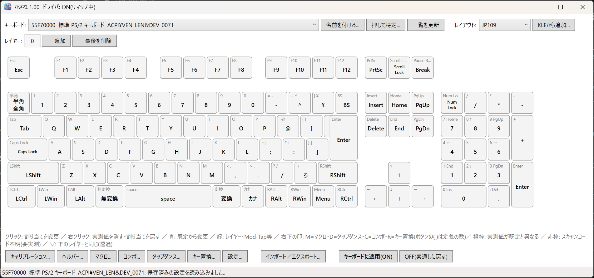

# kasane（かさね）

kasane は、Windows のキーボードの割り当てを変えるツールです。キーの入れ替え、レイヤーの切り替え、長押しとタップで動作を変える Mod-Tap と Layer-Tap、マクロ、コンボ、タップダンス、親指シフト（NICOLA）を、キーボードごとに設定できます。のどか（nodoka）の設定ファイルを取り込む機能もあります。

キー入力はキーボードフィルタドライバ（`kbdlayer.sys`）で処理します。



## 入手と動作環境

ビルド済みの kasane 1.01 は、Gumroad で配布しています。

- Subscription 版（サブスクリプション）: https://applet.gumroad.com/l/crijiq
- Pro 版（買い切り）: https://applet.gumroad.com/l/icbqj
- 評価版（Subscription 版の評価用ライセンスキーと zip ファイル）: https://applet.gumroad.com/l/nbmmf

評価版は 6 日間だけ使えます。あとで Subscription 版のライセンスキーを購入して設定すると、Subscription 版になります。

動作環境は次のとおりです。

- Windows 11 25H2（x64 または ARM64）
- インストールのための管理者権限
- インターネット接続（ライセンスキーの確認に使います。詳しくはヘルプの「ライセンスの認証」を参照）
  - Subscription 版の接続先: `https://kasane-license.applet-llc.workers.dev`
  - Pro 版の接続先（インストール時の 1 回だけ）: `https://api.gumroad.com/v2/licenses/verify`
  - どちらも HTTPS（443 番）です。社内のネットワークなどで止められていると、確認できません。

インストールから全機能の使い方までは、ヘルプにまとめています。ヘルプは日本語です。

- [ヘルプの目次](docs/manual/src/ja/index.md)
- [チュートリアル（GUI）](docs/TUTORIAL-GUI.md)

## 構成

| フォルダ | 内容 |
|---|---|
| `driver/kbdlayer` | キーボードフィルタドライバ（x64、ARM64） |
| `kasane` | 設定エディタ（WPF） |
| `kasane-tray`、`kasane-tray-uia` | タスクトレイに常駐するツール |
| `kasane-license`、`kasane-license-svc` | ライセンス管理（Subscription 版） |
| `kasane-pro-activator` | インストール時のライセンス確認（Pro 版） |
| `kasane-launcher` | Pro 版のインストーラーを起動するランチャー |
| `setup`、`setup-pro` | WiX によるインストーラー |
| `kasane.Tests` | 単体テストと UI Automation の試験 |
| `docs` | ヘルプとドキュメント |

## ビルド

Visual Studio 2022 と WDK を使います。`kasane.sln` を Release|x64 でビルドしてください。テストは次のコマンドで実行できます。

```powershell
dotnet test kasane.Tests
```

ビルドしたドライバを実機で読み込むには、署名が必要です。

## ライセンス

このリポジトリのソースコードは [Apache License 2.0](LICENSE) で公開しています。

次のものは対象外です。

- Gumroad で配布しているビルド済みのバイナリには、別の使用許諾（`setup/License`）が付いています。
- のどか（nodoka4）のソースコードを移した一部のファイルは、Eclipse Public License 2.0 に従います。
- そのほかの第三者のソフトウェアは、[THIRD-PARTY-NOTICES.txt](THIRD-PARTY-NOTICES.txt) と `third-party` フォルダに記載しています。

---

## English

kasane is a Windows keyboard remapping tool built on a keyboard filter driver (`kbdlayer.sys`). It supports key swaps, layers, Mod-Tap and Layer-Tap, macros, combos, tap dance and NICOLA (thumb-shift), configured per keyboard. It can also import nodoka configuration files.

Prebuilt binaries (version 1.01) are sold on Gumroad: [Subscription](https://applet.gumroad.com/l/crijiq) and [Pro (one-time purchase)](https://applet.gumroad.com/l/icbqj). A [trial version](https://applet.gumroad.com/l/nbmmf) (a Subscription evaluation license key and zip file) works for 6 days; if you later buy a Subscription license key and enter it, it becomes the Subscription edition. It requires Windows 11 25H2 (x64 or ARM64). The help pages are currently available in Japanese only.

The source code in this repository is licensed under the [Apache License 2.0](LICENSE). The prebuilt binaries are covered by a separate end-user license, some files derived from nodoka4 are under the Eclipse Public License 2.0, and other third-party components are listed in [THIRD-PARTY-NOTICES.txt](THIRD-PARTY-NOTICES.txt).
